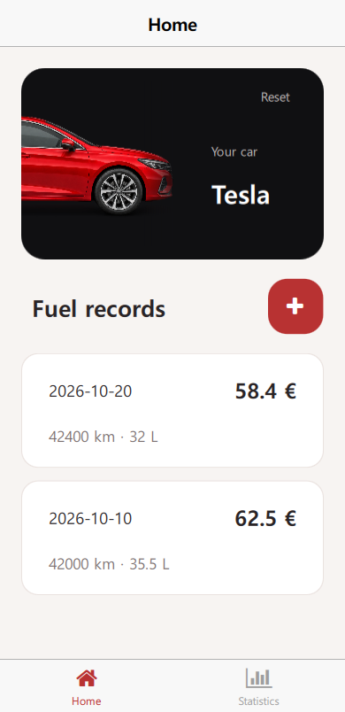
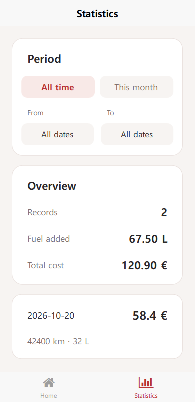

# CarLog

A fuel log built with [Felgo](https://felgo.com/), Qt Quick, and QML.
Register your car, save fuel records, and compare fuel purchases and spending
over a selected period.

| Home | Statistics |
| --- | --- |
|  |  |

## Features

- Car registration with a circular transition to Home.
- Add, edit, and delete fuel records with a date, odometer reading, liters, and cost in euros.
- Input validation and local storage that keeps records between launches.
- Home and Statistics tabs with shared record cards and entrance animations.
- Date filtering with record counts, total fuel added, and total cost.

## Run the app

1. Install the [Felgo SDK](https://felgo.com/) with a desktop kit.
2. Clone this repository and open `CMakeLists.txt` in Qt Creator.
3. Select the Felgo kit, configure the project, then build and run `appCarLog`.

The app has been checked on Windows with the Felgo MinGW desktop kit and Qt 6.8.3.
Reset on Home clears the car registration and all saved fuel records.

## Build-along tutorial

The tutorial explains how to build the app from a starter project.
It includes code snippets, screenshots, and steps for onboarding, validation,
storage, editing and deletion, statistics, and the circular page transition.

Build the `carlog_docs` CMake target in Qt Creator to generate the tutorial.
QDoc must be available; set `CARLOG_QDOC_EXECUTABLE` to its path if it is not
found automatically.

The target opens `build/docs/html/index.html` in your browser. The generated
site includes starter and completed project downloads. To share it, use the
whole `build/docs/html/` folder or `build/CarLog-tutorial.zip`.

Edit [docs/src/tutorial.qdoc](docs/src/tutorial.qdoc) to update the tutorial.

## Project structure

| Path | Contents |
| --- | --- |
| `qml/Main.qml` | App setup, theme, shared model, and navigation stack |
| `qml/pages/` | Onboarding, Home, Statistics, and the fuel-record form |
| `qml/components/` | Shared fields, cards, record list, date picker, and animations |
| `qml/model/` | App state and persistent storage operations |
| `qml/logic/` | Action signals and input validation |
| `docs/` | QDoc tutorial, screenshots, snippets, and generation scripts |

## License

See [LICENSE](LICENSE) for the MIT license.
